# Cyberdyne Terminal - T-800

<p align="center">
  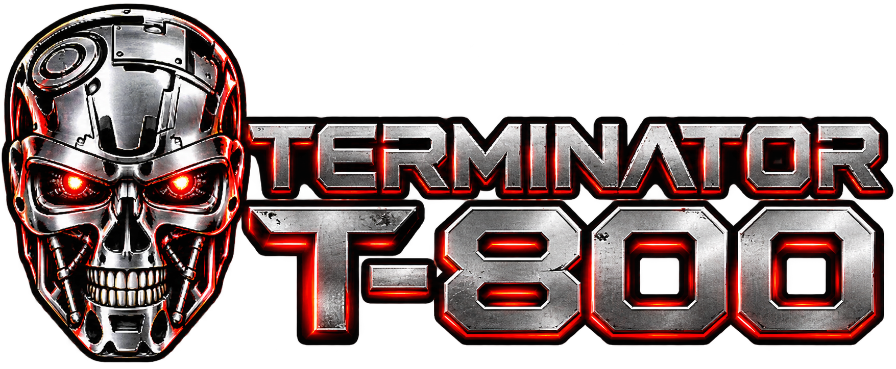
</p>

**Cyberdyne Terminal** es una aplicación web de página única (SPA) que
permite conversar con el **T-800 de *Terminator 2: Judgment Day*** mediante
inteligencia artificial generativa. El personaje responde con su estilo
lógico, directo y característico, conservando el contexto reciente del chat.

Proyecto Integrador del **Módulo 3 de Henry Full Stack**, desarrollado con
HTML, CSS y JavaScript, e integrado con Google Gemini a través de una
función serverless de Vercel.

**[Probar la aplicación][demo]**

## Índice

- [Cyberdyne Terminal - T-800](#cyberdyne-terminal---t-800)
  - [Índice](#índice)
  - [Descripción del personaje](#descripción-del-personaje)
  - [Características principales](#características-principales)
  - [Tecnologías utilizadas](#tecnologías-utilizadas)
  - [Vista previa de la aplicación](#vista-previa-de-la-aplicación)
    - [Demostración del chat](#demostración-del-chat)
  - [Arquitectura y estructura del proyecto](#arquitectura-y-estructura-del-proyecto)
  - [Requisitos previos](#requisitos-previos)
  - [Instalación y ejecución local](#instalación-y-ejecución-local)
    - [1. Clonar el repositorio](#1-clonar-el-repositorio)
    - [2. Instalar dependencias](#2-instalar-dependencias)
    - [3. Configurar la API key](#3-configurar-la-api-key)
    - [4. Iniciar la aplicación completa](#4-iniciar-la-aplicación-completa)
    - [Desarrollo de la interfaz por separado](#desarrollo-de-la-interfaz-por-separado)
  - [Variables de entorno y seguridad](#variables-de-entorno-y-seguridad)
  - [Pruebas automatizadas](#pruebas-automatizadas)
  - [Despliegue en Vercel](#despliegue-en-vercel)
    - [Despliegue desde GitHub](#despliegue-desde-github)
    - [Despliegue desde la terminal](#despliegue-desde-la-terminal)
  - [Uso de inteligencia artificial durante el desarrollo](#uso-de-inteligencia-artificial-durante-el-desarrollo)
    - [Ejemplos de prompts y solicitudes de apoyo](#ejemplos-de-prompts-y-solicitudes-de-apoyo)
    - [Cómo influyó la IA en las decisiones](#cómo-influyó-la-ia-en-las-decisiones)
  - [Autor y contexto académico](#autor-y-contexto-académico)

[Arquitectura y estructura del proyecto](#arquitectura-y-estructura-del-proyecto)
[uso-ia]: #uso-de-inteligencia-artificial-durante-el-desarrollo

## Descripción del personaje

El **T-800**, modelo 101, es un organismo cibernético creado por
Cyberdyne Systems. En *Terminator 2*, fue reprogramado para proteger
a John Connor y aprende progresivamente sobre el comportamiento humano.

Esta versión conversacional utiliza un *system prompt* específico para
recrear su personalidad: razonamiento lógico, respuestas directas,
interpretaciones literales, humor seco y referencias a su universo
cuando resultan naturales. El objetivo no es repetir frases de la
película, sino mantener una conversación coherente y reconocible.

El personaje responde en español y adapta la extensión de sus respuestas
al contexto.

## Características principales

- **SPA con History API:** navegación entre `/home`, `/chat` y `/about`
  sin recargar la página, con soporte para atrás y adelante del navegador.
- **Diseño responsive:** interfaz adaptada a celular, tablet y escritorio,
  con estilos CSS y distribuciones basadas en Flexbox y Grid.
- **Chat con Gemini:** respuestas generadas por IA mediante `/api/chat`.
- **Personalidad T-800:** instrucciones de sistema dedicadas al personaje.
- **Contexto conversacional:** historial en memoria durante la sesión.
  Cada solicitud incluye hasta los últimos **21 mensajes válidos**.
- **Experiencia de usuario:** burbujas diferenciadas, avatar del T-800,
  scroll automático e indicador de escritura y procesamiento.
- **Validaciones:** mensajes vacíos rechazados, bloqueo de envíos
  simultáneos y presentación segura de las respuestas como texto.
- **Manejo de errores:** mensajes específicos ante fallas de red,
  respuestas inválidas y límites de solicitudes de la API.
- **Testing:** pruebas automatizadas con Vitest y simulación de
  dependencias externas mediante *mocks*.

> El historial se conserva únicamente en memoria. Se pierde al recargar
> la página; no se utiliza `localStorage` ni una base de datos.

## Tecnologías utilizadas

| Área | Tecnología | Propósito |
| --- | --- | --- |
| Interfaz | HTML5, CSS3 | Estructura y diseño responsive |
| Lógica | JavaScript (ES Modules) | Interacciones, chat y navegación |
| Desarrollo | Vite | Servidor de desarrollo y compilación |
| IA | Google Gemini API | Generación de respuestas |
| Backend | Vercel Functions | Proxy seguro hacia Gemini |
| Despliegue | Vercel | Publicación de la aplicación |
| Testing | Vitest y jsdom | Pruebas de lógica e interfaz |
| Versionado | Git y GitHub | Control de versiones |

El modelo configurado actualmente en `server/gemini.js` es
`gemini-3.5-flash-lite`.

## Vista previa de la aplicación

Explorá las secciones de **Cyberdyne Terminal** y su adaptación
a dispositivos de escritorio, tablets y celulares.

<details>
  <summary><strong>Inicio (Home)</strong></summary>

  <h3>Desktop</h3>

  <p align="center">
    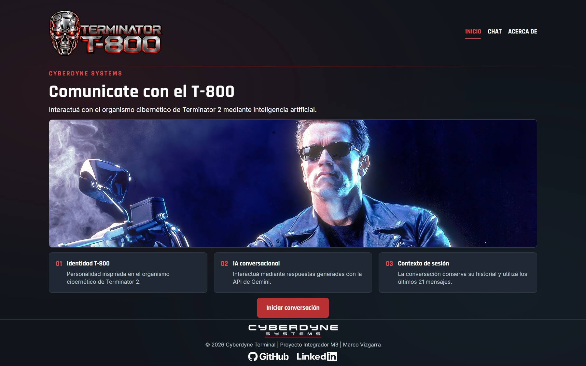
  </p>

  <h3>Tablet y Mobile</h3>

  <p align="center">
    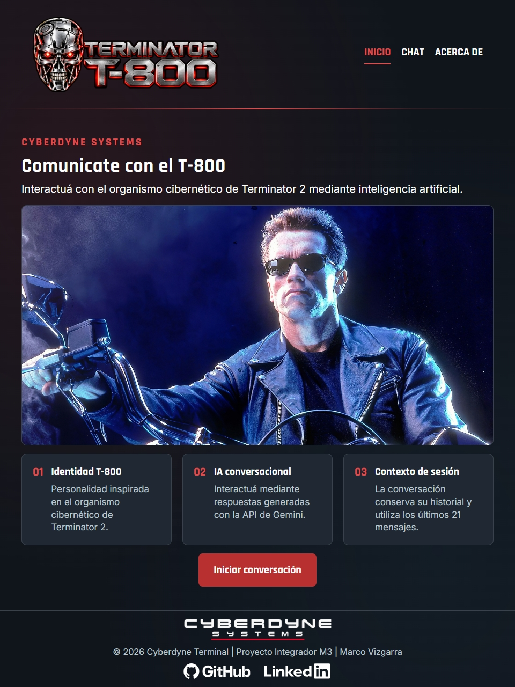
    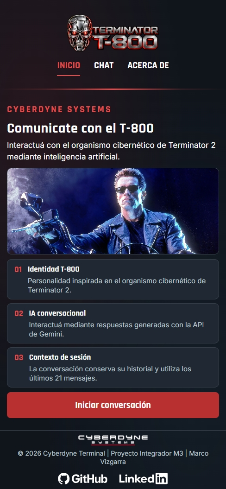
  </p>
</details>

<details>
  <summary><strong>Chat</strong></summary>

  <h3>Desktop</h3>

  <p align="center">
    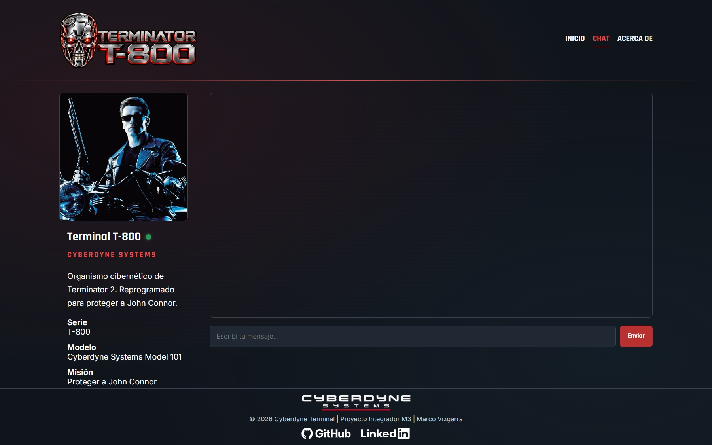
  </p>

  <h3>Tablet y Mobile</h3>

  <p align="center">
    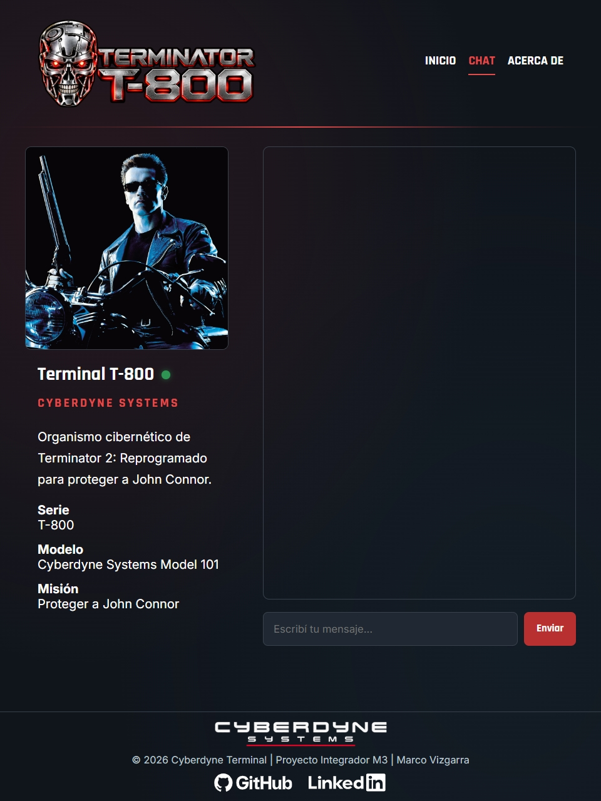
    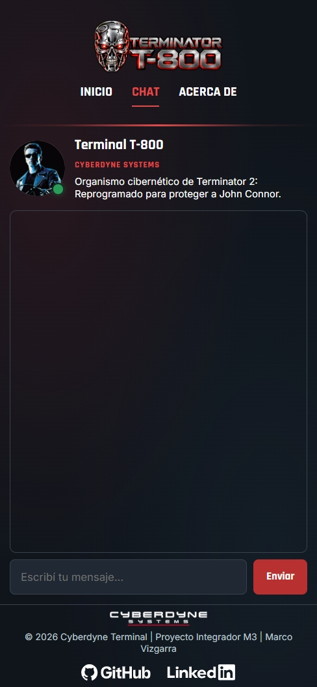
  </p>
</details>

<details>
  <summary><strong>Acerca del proyecto (About)</strong></summary>

  <h3>Desktop</h3>

  <p align="center">
    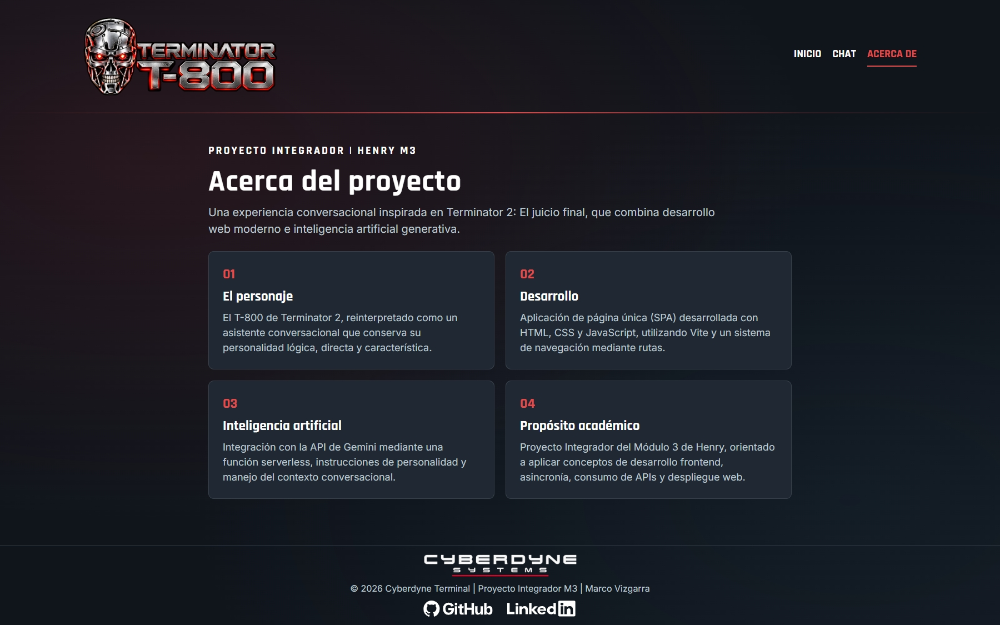
  </p>

  <h3>Tablet y Mobile</h3>

  <p align="center">
    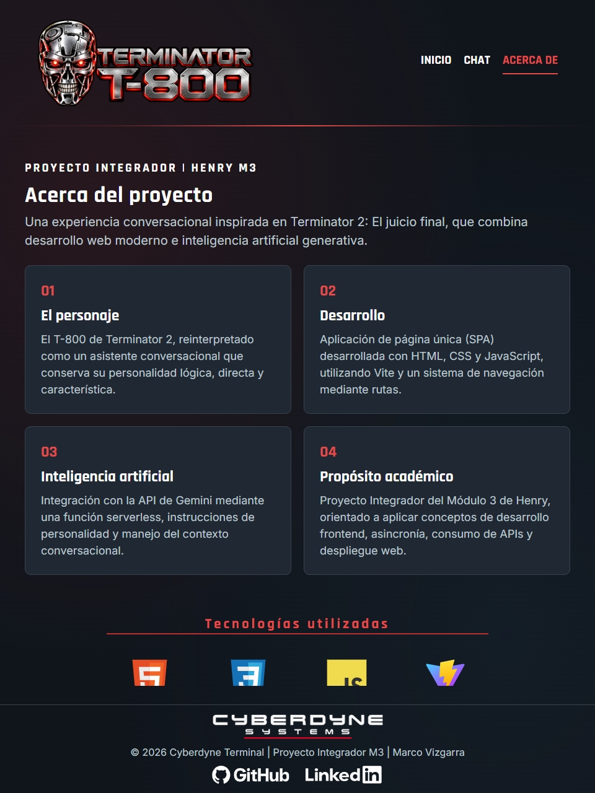
    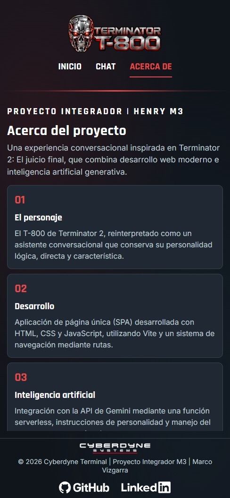
  </p>
</details>

### Demostración del chat

El siguiente GIF muestra una conversación con el T-800,
demostrando la generación de respuestas mediante inteligencia
artificial, su personalidad característica y el mantenimiento
del contexto conversacional.

<p align="center">
  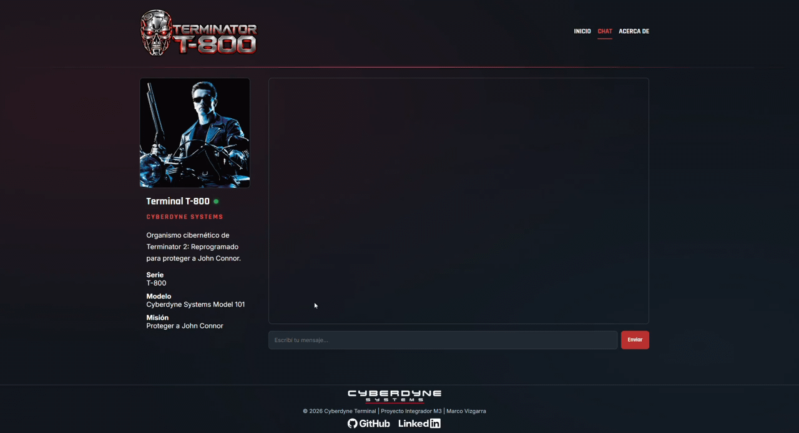
</p>

## Arquitectura y estructura del proyecto

El frontend es una SPA implementada con JavaScript modular. El router
cambia las vistas sin una recarga completa. El chat envía los mensajes a
un endpoint propio, que valida la solicitud y se comunica con Gemini
desde el servidor, sin entregar la API key al navegador.

```text
ProyectoM3_MarcoVizgarra/
├── api/
│   └── chat.js                 # Endpoint serverless /api/chat
├── server/
│   ├── gemini.js               # Solicitudes a Gemini y parseo
│   └── t800Prompt.js           # Personalidad del T-800
├── src/
│   ├── app.js                  # Punto de entrada de la SPA
│   ├── router.js               # Rutas e History API
│   ├── views.js                # Vistas Home, About y 404
│   ├── chat.js                 # Interfaz y estado del chat
│   ├── services/
│   │   └── chatApi.js          # Cliente HTTP para /api/chat
│   ├── css/
│   │   └── styles.css          # Estilos responsive
│   └── docs/
│       └── screenshots/        # Capturas y GIF del README
├── public/
│   └── img/                    # Logos e imágenes de la SPA
├── tests/
│   ├── router.test.js
│   ├── chat.test.js
│   ├── chatApi.test.js
│   ├── apiChat.test.js
│   └── gemini.test.js
├── index.html
├── .env.example
├── .gitignore
├── package.json
├── package-lock.json
├── vercel.json
└── README.md
```

**Flujo de una conversación:**

```text
Usuario (vista /chat)
    ↓
src/chat.js → src/services/chatApi.js
    ↓ POST /api/chat
api/chat.js (validación y manejo de errores)
    ↓
server/gemini.js + server/t800Prompt.js
    ↓ HTTPS con GEMINI_API_KEY del servidor
Google Gemini API
    ↓
Respuesta JSON → chat → interfaz
```

La solicitud utiliza el historial reciente con roles `user` y
`assistant`. En el servidor, el rol `assistant` se transforma en
`model`, según el formato esperado por Gemini.

## Requisitos previos

Para ejecutar el proyecto localmente necesitás:

- **Node.js** y **npm** instalados. El proyecto se desarrolló con
  Node.js 24; se recomienda utilizar una versión compatible con Vite.
- Una **API key de Gemini**, obtenida desde
  [Google AI Studio](https://aistudio.google.com/apikey).
- Acceso a **Vercel CLI** para ejecutar también la función serverless.
  Está incluida entre las dependencias de desarrollo.
- Git, para clonar el repositorio.

## Instalación y ejecución local

### 1. Clonar el repositorio

```bash
git clone https://github.com/marcovizgarra/ProyectoM3_MarcoVizgarra.git
cd ProyectoM3_MarcoVizgarra
```

### 2. Instalar dependencias

```bash
npm ci
```

### 3. Configurar la API key

Copiá el archivo `.env.example` a `.env`. En PowerShell:

```powershell
Copy-Item .env.example .env
```

Editá `.env` con tu clave real:

```dotenv
GEMINI_API_KEY=tu_api_key_real
```

No compartas este archivo ni lo subas a GitHub.

### 4. Iniciar la aplicación completa

Ejecutá el entorno local mediante Vercel:

```bash
npx vercel dev
```

Si es la primera vez que utilizás Vercel CLI, puede solicitarte
iniciar sesión y vincular el proyecto a Vercel. Seguí las instrucciones
de la terminal. Si el proyecto vinculado usa variables de entorno de
Vercel, verificá que `GEMINI_API_KEY` esté disponible también en el
entorno de desarrollo.

Abrí la dirección local que indique la terminal (habitualmente
`http://localhost:3000/home`). Así podrás probar la SPA **y** la ruta
`/api/chat` desde el mismo origen.

### Desarrollo de la interfaz por separado

```bash
npm run dev
```

Este comando inicia Vite para trabajar en el frontend, pero por sí solo
**no garantiza la ejecución de `/api/chat`**. Para probar la integración
completa con Gemini, utilizá `npx vercel dev`.

Otros comandos disponibles:

```bash
npm run build       # Genera el directorio dist/
npm run preview     # Previsualiza la compilación de Vite
```

## Variables de entorno y seguridad

| Variable | Ubicación | Uso |
| --- | --- | --- |
| `GEMINI_API_KEY` | Servidor / Vercel | Autenticación ante Gemini |

La clave se lee con `process.env.GEMINI_API_KEY` en
`server/gemini.js`. El frontend **nunca la necesita** y se comunica
únicamente con `/api/chat`.

La función serverless valida el método HTTP y el formato del historial
antes de enviar la solicitud a Gemini. También gestiona errores
como `400` (solicitud inválida), `405` (método no permitido),
`429` (límite de solicitudes) y `502` (fallo del servicio externo).

El repositorio incluye `.env.example` sin credenciales reales;
`.env`, `.env.local` y `.vercel/` están excluidos del control de
versiones mediante `.gitignore`.

## Pruebas automatizadas

El proyecto utiliza **Vitest** para validar funciones y comportamientos
clave sin depender de llamadas reales a Gemini.

Ejecutar todas las pruebas:

```bash
npm test
```

Modo observación, útil durante el desarrollo:

```bash
npm run test:watch
```

| Archivo | Comportamientos verificados |
| --- | --- |
| `router.test.js` | Rutas, navegación, `pushState`, `popstate` y 404 |
| `chat.test.js` | Envío, validaciones, historial y estados de interfaz |
| `chatApi.test.js` | Solicitud HTTP, respuestas y errores del cliente |
| `apiChat.test.js` | Validación del endpoint, códigos HTTP y errores |
| `gemini.test.js` | Prompt, roles, parseo y errores de Gemini |

Las pruebas emplean *mocks* de `fetch` y otras dependencias para
simular respuestas, límites de cuota y errores de red. Se puede
verificar la compilación del frontend con:

```bash
npm run build
```

## Despliegue en Vercel

La aplicación se despliega en Vercel; `vercel.json` configura la
reescritura de `/home`, `/chat` y `/about` hacia `index.html`, de modo
que también funcionen al acceder directamente desde el navegador.

### Despliegue desde GitHub

1. Ingresar en [Vercel](https://vercel.com/) e importar este repositorio.
2. Seleccionar la raíz del proyecto y configurar Vite como framework.
3. Utilizar `npm run build` como comando de compilación y `dist` como
   directorio de salida.
4. Crear `GEMINI_API_KEY` en la configuración de variables de entorno
   del proyecto, habilitándola para **Production**.
5. Desplegar y probar `/home`, `/chat`, `/about` y el envío de mensajes.

Al conectar el repositorio con Vercel, los nuevos cambios en la rama
de producción pueden desplegarse automáticamente según la configuración
del proyecto.

### Despliegue desde la terminal

Si el proyecto ya está vinculado a Vercel:

```bash
npx vercel --prod
```

La variable `GEMINI_API_KEY` también debe estar configurada en el
entorno **Production** de Vercel. No debe agregarse al código fuente.

**Aplicación publicada:**
[Cyberdyne Terminal en Vercel][demo]

## Uso de inteligencia artificial durante el desarrollo

Se utilizaron dos herramientas con propósitos diferentes:

- **Google Gemini API:** motor de IA que genera las respuestas del
  personaje durante el uso de la aplicación.
- **ChatGPT:** herramienta de apoyo para analizar alternativas,
  comprender conceptos, revisar código, depurar errores y preparar
  pruebas y documentación durante el desarrollo.

### Ejemplos de prompts y solicitudes de apoyo

Los siguientes ejemplos resumen solicitudes realizadas durante el
proceso de implementación y las decisiones asociadas:

- **CSS:** revisar redundancias y reorganizar reglas sin rediseñar la
  interfaz. Decisión: conservar el diseño visual existente.
- **Responsive:** refactorizar los estilos a un enfoque mobile-first.
  Decisión: partir de estilos móviles y extenderlos progresivamente.
- **Testing:** crear pruebas con Vitest y *mocks*. Decisión: probar
  casos exitosos, entradas inválidas y errores de API.
- **Personaje:** evitar referencias repetitivas y frases forzadas.
  Decisión: mencionar a John Connor y frases icónicas solo si encajan.
- **Integración:** investigar errores de Gemini y del despliegue.
  Decisión: manejar explícitamente fallos y límites de cuota.

### Cómo influyó la IA en las decisiones

Las sugerencias no se incorporaron de manera automática. Se revisaron
según la consigna, la estructura existente y el comportamiento esperado
de la aplicación. Por ejemplo:

- Se separaron el router, la interfaz del chat, la comunicación HTTP,
  el endpoint serverless y la integración con Gemini.
- Se mantuvo `GEMINI_API_KEY` exclusivamente del lado del servidor.
- Se ajustó iterativamente el *system prompt* para equilibrar
  fidelidad al personaje y naturalidad conversacional.
- Se incorporaron pruebas automatizadas para detectar regresiones
  y validar el manejo de errores sin consumir solicitudes reales.
- Se priorizó conservar la apariencia de la interfaz al reorganizar
  sus estilos responsive.

El *system prompt* implementado para el personaje puede consultarse
en [`server/t800Prompt.js`](server/t800Prompt.js). Las decisiones se
contrastaron con pruebas manuales, ejecución local y tests, en lugar
de dar por correctas las respuestas de la herramienta de IA.

## Autor y contexto académico

**Marco Vizgarra**  
Proyecto Integrador - Módulo 3  
**Henry Full Stack - 2026**

- **GitHub:** [marcovizgarra](https://github.com/marcovizgarra)
- **Demo:** [Cyberdyne Terminal](https://proyecto-m3-marco-vizgarra.vercel.app/home)

Proyecto académico inspirado en el universo de *Terminator 2*.

[demo]: https://proyecto-m3-marco-vizgarra.vercel.app/home
